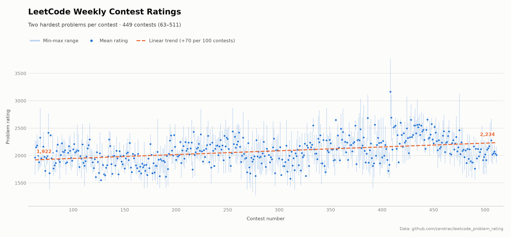
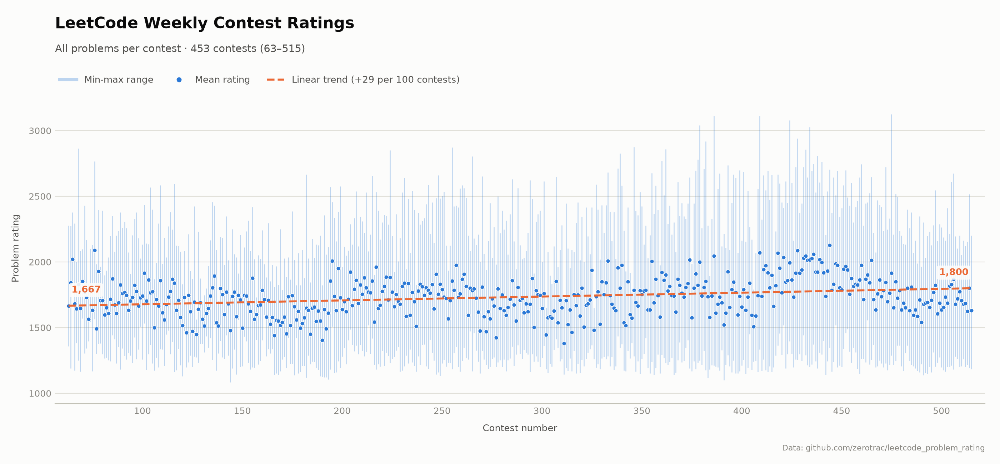
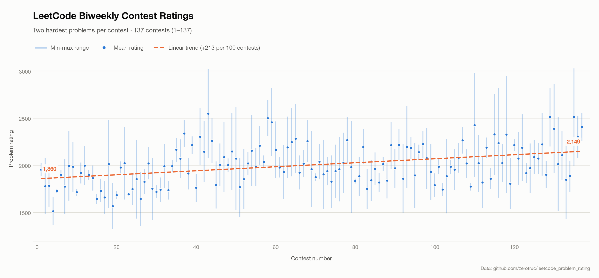
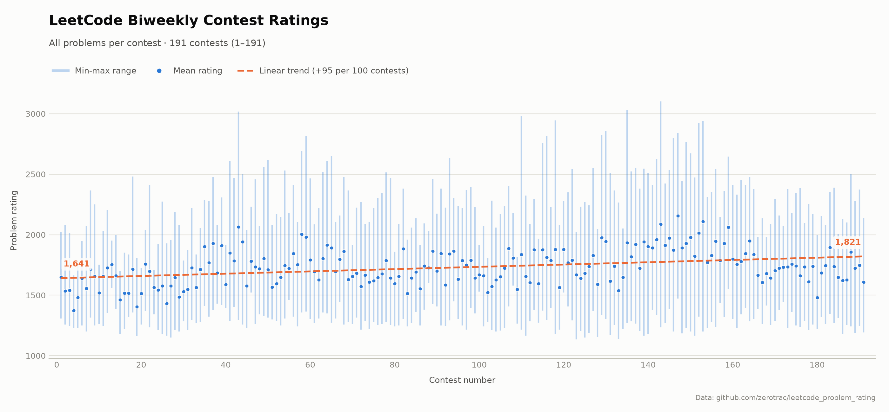

# LeetCode Contest Ratings Visualization

This project generates and updates visualizations of LeetCode contest problem ratings. It processes data from LeetCode's problem ratings and creates candlestick charts for both weekly and biweekly contests, showcasing the minimum, maximum, and mean ratings.

## Generated Diagrams

Below are the latest visualizations of the contest ratings:

Each chart shows the min-max rating range per contest, the mean as a marker, and a
linear trend through the means. Every chart ships in a light and a dark render;
GitHub picks the one matching your theme.

### Weekly Contest Ratings - Top 2 Hardest Problems
<picture>
  <source media="(prefers-color-scheme: dark)" srcset="./leetcode_weekly_ratings_top2_dark.png">
  
</picture>

### Weekly Contest Ratings - All Problems
<picture>
  <source media="(prefers-color-scheme: dark)" srcset="./leetcode_weekly_ratings_dark.png">
  
</picture>

### Biweekly Contest Ratings - Top 2 Hardest Problems
<picture>
  <source media="(prefers-color-scheme: dark)" srcset="./leetcode_biweekly_ratings_top2_dark.png">
  
</picture>

### Biweekly Contest Ratings - All Problems
<picture>
  <source media="(prefers-color-scheme: dark)" srcset="./leetcode_biweekly_ratings_dark.png">
  
</picture>

These charts are automatically updated approximately once a month using GitHub Actions.

## Data Source

The problem ratings data is sourced from the [zerotrac/leetcode_problem_rating](https://github.com/zerotrac/leetcode_problem_rating) repository.

## License

This project is licensed under the MIT License.